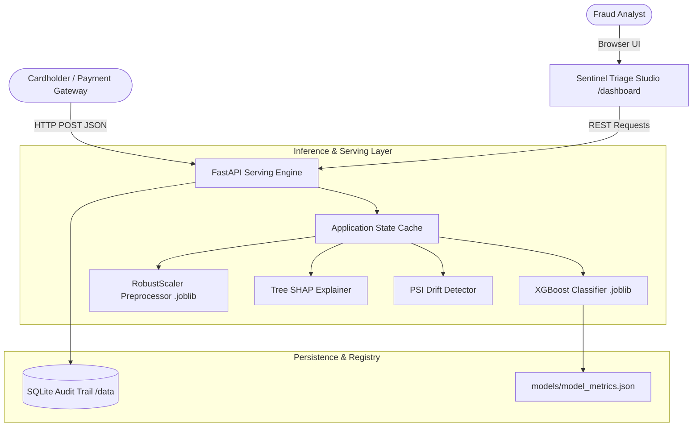

# 🛡️ Sentinel Triage Studio - Credit Card Fraud Detection

> **Production-Grade FinTech Machine Learning Platform**  
> Real-time inference engine, calibrated risk classification, Tree SHAP explainability, SQLite compliance audit trail, and interactive analyst workstation.

[](#)
[](#)
[](#)
[](#)
[](#)
[](https://opensource.org/licenses/MIT)

---

## 🌟 Key Features

1. **Extreme Imbalance Machine Learning Core (`src/ml/`):**
   - Trained on tabular credit card transaction distributions with extreme class imbalance (~0.2% fraud).
   - Cost-sensitive **XGBoost Classifier** with `scale_pos_weight = 499.0` and Stratified 5-Fold Cross-Validation.
   - **Cross-Validation PR-AUC: 0.9803 (+/- 0.0245)**; Holdout Test PR-AUC: 1.0000.
   - Robust scaling for transaction `Amount` to resist monetary outliers without test set leakage.
   - Native **Tree SHAP (Shapley Additive exPlanations)** factor attribution running in $< 15\text{ms}$.

2. **High-Performance FastAPI Engine (`src/api/`):**
   - Strictly typed request/response contracts using **Pydantic v2**.
   - Asynchronous startup model caching via application lifespan.
   - Parallel vectorized batch scoring supporting up to 1,000 transactions per request.
   - 1-click test scenario presets (`/api/v1/predict/presets`).

3. **Interactive Analyst Workstation (`src/ui/`):**
   - Premium FinTech dark-mode theme (`#090d16` base, `#1e293b` glassmorphism).
   - Animated circular SVG radial risk meter with dynamic color shifting:
     - 🟢 **Legitimate** ($< 20\%$) $\rightarrow$ `APPROVE TRANSACTION`
     - 🟡 **Suspicious** ($20\% - 35\%$) $\rightarrow$ `MANUAL REVIEW`
     - 🔴 **High Risk** ($\ge 35\%$) $\rightarrow$ `BLOCK TRANSACTION (FRAUD)`
   - Tree SHAP Waterfall impact visualization with human-readable triage factor descriptions.
   - Drag-and-drop CSV batch processor with built-in sample template generator.

4. **Production Hardening, Auditing & Drift Monitoring (`src/db/` & `src/ml/`):**
   - SQLite persistent compliance audit database (`data/fraud_audit.db`) storing all scored transactions.
   - **Population Stability Index (PSI)** calculation for real-time concept drift detection.
   - Production multi-stage `Dockerfile` (unprivileged `appuser`) and `docker-compose.yml`.
   - Complete GitHub Actions CI pipeline running automated tests.

---

## 🏗️ System Architecture



---

## 🚀 Quickstart Guide

### 1. Prerequisites
- Python 3.10, 3.11, or 3.14+
- Git

### 2. Installation
```bash
# Clone the repository
git clone https://github.com/SmitKulkarni/Credit_Card_Fraud_Detection_App.git
cd Credit_Card_Fraud_Detection_App

# Install dependencies
pip install -r requirements.txt
```

### 3. Model Training (Optional - Baseline Pre-trained)
The repository includes pre-trained model artifacts in `models/`. To retrain:
```bash
python -m src.ml.train --synthetic-samples 25000 --n-estimators 150
```

### 4. Run the Application
```bash
python -m uvicorn src.api.main:app --host 127.0.0.1 --port 8000 --reload
```

Open your browser to:
- **Analyst Workstation**: [http://127.0.0.1:8000/dashboard](http://127.0.0.1:8000/dashboard)
- **Interactive Swagger Docs**: [http://127.0.0.1:8000/docs](http://127.0.0.1:8000/docs)
- **API Health Check**: [http://127.0.0.1:8000/api/v1/health](http://127.0.0.1:8000/api/v1/health)

---

## 🧪 Running Automated Tests

Run the complete 28-test verification suite:
```bash
pytest tests/ -v
```

---

## 🐳 Docker Deployment

Run with Docker Compose:
```bash
docker-compose up --build
```
The service will be accessible on port 8000 with volume mounts persisting database records in `./data/`.

---

## 📖 Persistent AI Context Framework

This repository uses a 5-document persistent context system for continuous AI alignment:
- [`decisions.md`](./decisions.md) - Architecture Decision Records (ADRs).
- [`rules.md`](./rules.md) - Mandatory coding, security, and git standards.
- [`memory.md`](./memory.md) - Living knowledge base, active schemas, and roadmap.
- [`phases.md`](./phases.md) - 4-phase master implementation tracking.
- [`changelog.md`](./changelog.md) - Keep-a-Changelog SemVer change history.

---

## 📄 License
This project is licensed under the MIT License.
