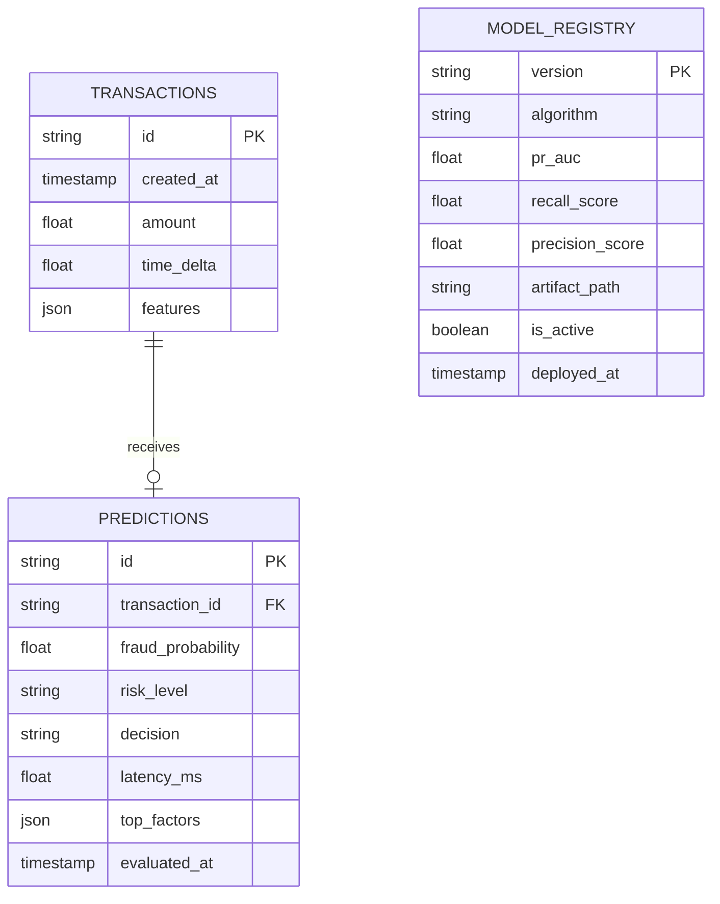
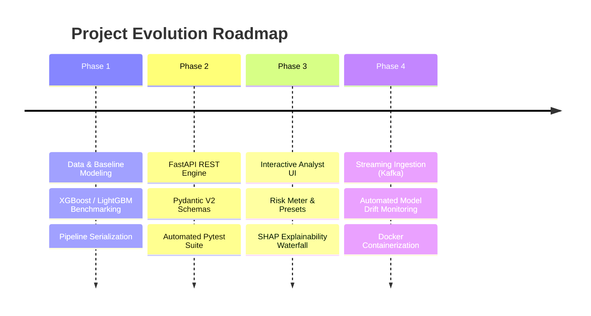

# Project Memory & Knowledge Base

This file serves as the single source of truth for the ongoing state, architecture, roadmap, and domain knowledge of the **Credit Card Fraud Detection App**. All AI agents and collaborators should consult and update this document to maintain uninterrupted context.

---

## 1. Project Overview

- **Project Name:** Credit Card Fraud Detection Application
- **Domain:** FinTech, Cyber Security, Applied Machine Learning, Artificial Intelligence & Data Science (AIDS)
- **Primary Goal:** Provide a low-latency, highly accurate fraud detection platform capable of evaluating credit card transactions in real time, calculating calibrated fraud risk scores (0.0% - 100.0%), and delivering actionable interpretability for fraud triage teams.
- **Key Challenge:** Addressing extreme class imbalance (typically ~0.172% fraud incidence) while avoiding excessive false alarms that disrupt legitimate customer purchases.

---

## 2. Tech Stack

| Layer | Technology | Purpose |
| :--- | :--- | :--- |
| **Backend & API** | Python 3.10+, FastAPI, Pydantic v2, Uvicorn | Asynchronous REST API, input validation, high-throughput model serving |
| **Machine Learning Core** | Scikit-Learn, XGBoost, LightGBM, Joblib / ONNX | Classification, probability estimation, pipeline serialization |
| **Explainability (XAI)** | SHAP (`TreeExplainer`), Matplotlib/Plotly (optional) | Per-transaction feature contribution breakdown |
| **Data Processing** | Pandas, NumPy, Scipy | Tabular feature transformations, scaling, train/test splitting |
| **Frontend / Dashboard** | HTML5, Modern Vanilla CSS3 (Custom Design System), ES6+ JS | Responsive financial analyst dashboard, risk meter, live testing |
| **Testing & Quality** | Pytest, Flake8 / Black, HTTPX | Automated unit, schema, and API integration testing |
| **Storage & Caching** | SQLite / PostgreSQL (planned), Local File Artifacts | Transaction audit logs, model registry, metrics cache |

---

## 3. Features Completed

- [x] **Repository & Version Control Initialization:** Git repository setup and structure initialized.
- [x] **Persistent AI Context Architecture:**
  - `decisions.md` (ADR framework & fundamental decisions)
  - `rules.md` (Coding standards, folder structure, UI/UX, security, non-destructive rules)
  - `memory.md` (Long-term state, schema, business logic, and roadmap)
  - `phases.md` (4-phase implementation roadmap, task checklists, and acceptance criteria)
  - `changelog.md` (Keep-a-Changelog tracking)
- [x] **System Architecture Design:** Decoupled FastAPI backend and modern UI dashboard specification.
- [x] **Phase 1: Machine Learning Core Pipeline:**
  - `src/ml/data_loader.py`: Ingestion, schema validation, and high-fidelity synthetic fallback generator.
  - `src/ml/preprocessor.py`: Outlier-resistant `RobustScaler` for Amount, Time normalization, aligned 30-feature vector.
  - `src/ml/train.py`: Stratified 5-Fold cross-validation (`CV PR-AUC = 0.9803 +/- 0.0245`), `scale_pos_weight = 499.0`.
  - `src/ml/evaluate.py`: PR-AUC, ROC-AUC, financial cost matrix, F1-based threshold calibration.
  - `src/ml/explainer.py`: Exact Tree SHAP feature contribution extraction and human-readable risk factors.
  - `src/ml/predictor.py`: Real-time (`< 15ms`) and vectorized batch inference engine with caching.
  - `tests/test_ml.py`: 11 unit & integration tests passing (100% pass rate).
  - Serialized Artifacts: `models/preprocessor.joblib`, `models/fraud_detector_xgb.joblib`, `models/model_metrics.json`.
- [x] **Phase 2: High-Performance FastAPI Serving Engine:**
  - `src/api/main.py`: Application factory, async lifespan model loading into state, CORS, exception handlers.
  - `src/api/config.py`: Centralized Pydantic Settings reading environment configurations.
  - `src/api/schemas/transaction.py`: Pydantic v2 schemas (`TransactionInput`, `PredictionResponse`, `BatchTransactionRequest`).
  - `src/api/routes/health.py`: Live health inspection and model registry metadata.
  - `src/api/routes/predict.py`: Real-time scoring, batch scoring, and 3 curated presets.
  - `src/api/routes/analytics.py`: Real-time rolling session statistics and latency percentiles.
  - `tests/test_api.py`: 9 integration tests covering all routes, presets, and validation edge cases.

- [x] **Phase 3: Interactive Analyst Dashboard & XAI Visualization:**
  - `src/ui/index.html`: Responsive single-page analyst workstation with KPI ribbon, dual views, and audit trail.
  - `src/ui/css/styles.css`: FinTech dark theme design system with financial risk tokens (`#10b981`, `#f59e0b`, `#ef4444`).
  - `src/ui/js/presets.js`: Curated scenario injectors (Normal, Suspicious, Confirmed Fraud, and Random Generator).
  - `src/ui/js/chart.js`: Animated SVG circular risk gauge and Tree SHAP waterfall feature breakdown renderer.
  - `src/ui/js/app.js`: Live REST client, auto-refreshing KPIs, form orchestration, and batch CSV processor with sample downloader.
  - Mounted live dashboard at `/dashboard` endpoint in FastAPI.

- [x] **Phase 4: Production Hardening, Monitoring & Deployment:**
  - `src/db/`: SQLAlchemy declarative database engine and `TransactionAuditRecord` persistence model (`data/fraud_audit.db`).
  - `src/ml/drift_detector.py`: Population Stability Index (PSI) calculator for data drift and concept drift monitoring.
  - `Dockerfile`: Multi-stage, non-root `appuser` production image with native healthcheck.
  - `docker-compose.yml`: Unified service orchestration with volume persistence for `data/` and `models/`.
  - `.github/workflows/ci.yml`: GitHub Actions CI pipeline running training smoke tests and pytest across Python 3.10 and 3.11.
  - `tests/test_audit_and_drift.py`: 7 automated tests covering database persistence, pagination, PSI math, and drift API.

---

## 4. Pending Features (Backlog)

- [ ] **Streaming Ingestion:** Real-time Apache Kafka / AWS Kinesis transaction consumer integration.
- [ ] **Multi-Model Shadow Scoring:** A/B model comparison in live production.

---

## 5. API Endpoints Specification

| Method | Path | Description | Status |
| :--- | :--- | :--- | :--- |
| `GET` | `/` | Root API descriptor and OpenAPI documentation links | **Active** |
| `GET` | `/api/v1/health` | Liveness, uptime, & model readiness check | **Active** |
| `GET` | `/api/v1/model/metadata` | Active model version, PR-AUC, and decision thresholds | **Active** |
| `POST` | `/api/v1/predict` | Score a single transaction (with optional Tree SHAP factors & DB audit logging) | **Active** |
| `POST` | `/api/v1/predict/batch` | Vectorized bulk transaction evaluation (up to 1,000 items & batch DB logging) | **Active** |
| `GET` | `/api/v1/predict/presets` | 3 pre-configured demo scenarios (Normal, Suspicious, Fraud) | **Active** |
| `GET` | `/api/v1/analytics/stats` | Rolling session statistics, fraud rate, and latency metrics | **Active** |
| `GET` | `/api/v1/analytics/history` | Paginated query of persistent audit records with risk tier filtering | **Active** |
| `POST` | `/api/v1/analytics/drift-check` | Batch evaluation of Population Stability Index (PSI) drift against baseline | **Active** |

### Payload Contract (`POST /api/v1/predict`)

#### Request Body
```json
{
  "transactionId": "tx_98124019",
  "time": 406.0,
  "amount": 149.62,
  "features": {
    "V1": -2.31,
    "V2": 1.95,
    "V3": -1.60,
    "V4": 3.99,
    "V5": -0.52,
    "...": "...",
    "V28": 0.13
  },
  "includeExplanation": true
}
```

#### Response Body
```json
{
  "transactionId": "tx_98124019",
  "fraudProbability": 0.884,
  "isFraud": true,
  "riskLevel": "HIGH",
  "decision": "BLOCK_TRANSACTION",
  "confidence": 0.884,
  "latencyMs": 8.4,
  "topFactors": [
    { "feature": "V14", "impact": 0.312, "description": "High negative deviation in behavioral component 14" },
    { "feature": "V4", "impact": 0.218, "description": "High positive anomaly in velocity component 4" },
    { "feature": "Amount", "impact": 0.054, "description": "Transaction amount outlier" }
  ],
  "evaluatedAt": "2026-10-25T11:50:00Z"
}
```

---

## 6. Database Schema Summary

Planned audit and operational database (SQLite for local dev, PostgreSQL for production):



---

## 7. Important Business Logic & Rules

1. **Classification Decision Thresholds:**
   - Standard 0.5 threshold is **sub-optimal** for imbalanced fraud.
   - **Tuned Threshold Policy:**
     - `Probability < 0.25`: **LOW RISK** $\rightarrow$ Automatic Approval.
     - `0.25 <= Probability < 0.65`: **MEDIUM RISK** $\rightarrow$ Step-Up Authentication (OTP / 2FA or Analyst Review).
     - `Probability >= 0.65`: **HIGH RISK** $\rightarrow$ Immediate Decline / Freeze.
2. **Cost-Matrix Tradeoff:**
   - Cost of False Negative (missing a \$1,000 fraud charge) $\gg$ Cost of False Positive (asking customer to confirm an SMS code).
   - The optimization function explicitly penalizes missed fraud 10x heavier than a manual review trigger.
3. **Feature Anonymization Context:**
   - Features $V_1$ through $V_{28}$ are principal components obtained via PCA due to confidentiality.
   - `Time` represents seconds elapsed between this transaction and the first transaction in the dataset.
   - `Amount` is the transaction sum in standard currency units.

---

## 8. Known Issues & Technical Constraints

- **Class Imbalance Sensitivity:** Standard stratified sampling can yield zero fraud samples in smaller subsets if not partitioned carefully.
- **SHAP Computation Overhead:** Computing exact SHAP values for high-frequency batch requests can introduce CPU bottleneck; batch endpoint defaults `includeExplanation = false`.
- **Cold-Start Model Loading:** Loading model weights on every request must be avoided; model must be loaded once into FastAPI application state (`app.state.model`) during startup lifespan.

---

## 9. Future Roadmap


