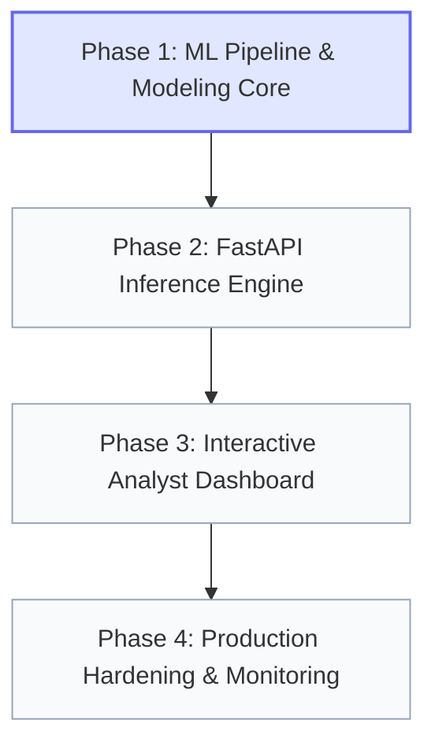

# Project Implementation Phases & Milestones

This document provides the authoritative, step-by-step implementation roadmap for the **Credit Card Fraud Detection App**. Each phase defines clear technical deliverables, task checklists, dependencies, and acceptance criteria.

---

## 1. Master Phase Roadmap Overview



### Phase Summary Matrix

| Phase | Title | Primary Objective | Key Deliverables | Status |
| :---: | :--- | :--- | :--- | :---: |
| **Phase 1** | **Data Engineering & ML Core** | Build and benchmark imbalanced fraud classifiers | Preprocessor, XGBoost/LightGBM pipelines, SHAP explainer, serialized models | **Completed** |
| **Phase 2** | **FastAPI Serving Engine** | Construct low-latency, validated REST API | Pydantic v2 schemas, `/predict`, `/batch`, `/health`, Pytest test suite | **Completed** |
| **Phase 3** | **Interactive Analyst Dashboard** | Deliver rich visual interface for transaction review | Risk gauge, scenario presets, SHAP waterfall UI, CSV batch evaluator | **Completed** |
| **Phase 4** | **Hardening, Monitoring & Deploy** | Production readiness, audit trails, and drift monitoring | SQLite/PostgreSQL audit logs, drift detector, Docker container, CI/CD | **Completed** |

---

## 2. Phase 1: Data Engineering & Machine Learning Foundation

### 1.1 Objective
Construct an automated data ingestion, preprocessing, training, and model evaluation pipeline that effectively tackles extreme credit card transaction imbalance (~0.17% fraud) and outputs serialized inference models.

### 1.2 Target File Structure
```text
src/ml/
├── __init__.py
├── data_loader.py       # Dataset ingestion & synthetic fallback generator
├── preprocessor.py      # RobustScaler for Amount, Time normalization, PCA feature validation
├── train.py             # Stratified K-Fold, XGBoost with scale_pos_weight, PR-AUC tuning
├── evaluate.py          # Confusion matrix, Precision-Recall curve, ROC-AUC, classification report
├── explainer.py         # SHAP TreeExplainer wrapper for real-time feature contributions
└── predictor.py         # Lightweight inference wrapper loading serialized artifacts
```

### 1.3 Implementation Tasks
- [x] **Task 1.1: Dataset Ingestion & Validation (`data_loader.py`)**
  - Download or load benchmark European cardholder dataset (`creditcard.csv`).
  - Provide a synthetic generator fallback (`generate_synthetic_transactions()`) to enable zero-dependency unit tests without external 150MB files.
  - Implement data integrity assertions (checking for missing values, shape validation).
- [x] **Task 1.2: Feature Preprocessing Pipeline (`preprocessor.py`)**
  - Fit and persist `RobustScaler` on `Amount` (to handle extreme financial outliers).
  - Transform `Time` into periodic or normalized transaction intervals.
  - Preserve PCA features ($V_1 - V_{28}$) without leaking test set statistics.
  - Serialize preprocessor state using `joblib` into `models/preprocessor.joblib`.
- [x] **Task 1.3: Imbalanced Model Training & Tuning (`train.py`)**
  - Implement Stratified K-Fold cross-validation (5-fold).
  - Calculate optimal `scale_pos_weight = (count(legitimate) / count(fraud))`.
  - Train **XGBoost** classifier and **LightGBM** benchmark.
  - Calibrate probability threshold using Precision-Recall curve to maximize F1-score on the minority class.
  - Export best model to `models/fraud_detector_xgb.joblib`.
- [x] **Task 1.4: Evaluation & Diagnostics (`evaluate.py`)**
  - Generate evaluation metrics: PR-AUC, ROC-AUC, Recall@95% Precision, Cost Matrix Score.
  - Export evaluation metrics summary to `models/model_metrics.json`.
- [x] **Task 1.5: SHAP Explainability Engine (`explainer.py`)**
  - Initialize exact native Tree SHAP calculation on the fitted XGBoost booster.
  - Build helper function `explain_instance(features_array)` returning top factors with directional risk contribution and descriptions.
- [x] **Task 1.6: Inference Wrapper (`predictor.py`)**
  - Create unified `FraudPredictor` class with `.predict_single()` and `.predict_batch()` methods, including latency timing and caching.

### 1.4 Acceptance Criteria
1. Machine learning pipeline achieves **PR-AUC $\ge 0.85$** on validation splits.
2. Single transaction inference latency is **$< 15\text{ms}$** (without SHAP) and **$< 50\text{ms}$** (with SHAP).
3. Preprocessor and model artifacts successfully saved and reloadable without warning.
4. Synthetic generator passes complete training and prediction smoke test in `< 5\text{s}`.

---

## 3. Phase 2: High-Performance Inference Engine (FastAPI)

### 2.1 Objective
Wrap the trained model in an asynchronous, strictly typed REST API with comprehensive schema validation, batch processing, and health diagnostics.

### 2.2 Target File Structure
```text
src/api/
├── __init__.py
├── main.py              # FastAPI app initialization, lifespan, CORS, error handlers
├── config.py            # Environment configurations (thresholds, model paths)
├── schemas/
│   ├── __init__.py
│   └── transaction.py   # Pydantic v2 TransactionInput, PredictionOutput, BatchSchemas
└── routes/
    ├── __init__.py
    ├── health.py        # /health and /model/metadata endpoints
    ├── predict.py       # /predict and /predict/batch endpoints
    └── analytics.py     # /analytics/stats endpoint
```

### 2.3 Implementation Tasks
- [x] **Task 2.1: Configuration & Environment (`config.py`)**
  - Configure `Settings` via Pydantic Settings (`MODEL_PATH`, `PREPROCESSOR_PATH`, `DEFAULT_THRESHOLD`, `CORS_ORIGINS`).
  - Read from `.env` file with sensible fallback defaults.
- [x] **Task 2.2: Pydantic Data Contracts (`schemas/transaction.py`)**
  - `TransactionInput`: Validates `time`, `amount`, and $V_1 - V_{28}$ floats with nested/flat support.
  - `PredictionResponse`: Formats `riskScore`, `isFraud`, `riskLevel` (`LOW`, `MEDIUM`, `HIGH`), `decision`, `latencyMs`, and `topFactors`.
  - `BatchTransactionRequest`: Validates array of transactions (capped at 1,000 items per request).
  - Include built-in schema examples and preset scenarios (`PresetScenario`).
- [x] **Task 2.3: Application Lifespan & Model Loader (`main.py`)**
  - Implement FastAPI `lifespan` handler to load models into `app.state.predictor` during startup.
  - Configure CORS middleware for local frontend connectivity.
  - Implement centralized exception handler returning standardized JSON error envelopes.
- [x] **Task 2.4: Prediction Endpoints (`routes/predict.py`)**
  - `POST /api/v1/predict`: Processes single transaction with optional SHAP query flag.
  - `POST /api/v1/predict/batch`: High-performance vectorized batch inference.
  - `GET /api/v1/predict/presets`: Returns curated demo presets (Normal, Suspicious, Fraud).
- [x] **Task 2.5: System Health & Diagnostic Endpoints (`routes/health.py`)**
  - `GET /api/v1/health`: Returns API status, uptime, and model loaded status.
  - `GET /api/v1/model/metadata`: Returns active model name, training timestamp, and metric benchmarks.
- [x] **Task 2.6: Analytics & Monitoring Routes (`routes/analytics.py`)**
  - `GET /api/v1/analytics/stats`: Rolling session metrics, fraud rate, and latency percentiles.
- [x] **Task 2.7: Automated Integration Tests (`tests/test_api.py`)**
  - Pytest suite testing `/health`, `/predict` (fraud scenario), `/predict` (normal scenario), `/predict/batch`, presets, and validation error handling (`422`).

### 2.4 Acceptance Criteria
1. All endpoints conform to documented request/response contracts in `memory.md`.
2. Invalid payloads (missing fields, wrong types, negative amount) return HTTP `422` with clear field errors.
3. Batch endpoint scores 100 transactions in $< 100\text{ms}$.
4. Complete test suite passes with 100% success rate via `pytest tests/`.

---

## 4. Phase 3: Interactive Analyst Dashboard & XAI Visualization

### 3.1 Objective
Deliver a responsive, modern web interface tailored for fraud triage officers, featuring live transaction testing, visual risk scoring, pre-filled scenarios, and explainability breakdown.

### 3.2 Target File Structure
```text
src/ui/
├── index.html           # Single-page analyst workstation
├── css/
│   └── styles.css       # Premium dark-mode design system with financial palette
└── js/
    ├── app.js           # Core state management and API client
    ├── presets.js       # Pre-configured normal & fraudulent transaction payloads
    └── chart.js         # Lightweight risk meter & feature importance rendering
```

### 3.3 Implementation Tasks
- [x] **Task 3.1: Design System & Layout Foundation (`styles.css`, `index.html`)**
  - Implement modern dark-mode palette: Deep slate `#090d16`, card surface `#1e293b`, borders `#334155`.
  - Financial risk status tokens: Emerald (`#10b981`), Amber (`#f59e0b`), Crimson (`#ef4444`).
  - Responsive header with live API connection indicator and active model badge.
- [x] **Task 3.2: Transaction Inspection Form & Presets (`index.html`, `presets.js`)**
  - Input controls for `Amount`, `Time`, and collapsible accordion for $V_1 - V_{28}$.
  - One-click preset injector buttons:
    - 🟢 **"Load Legitimate Purchase"** (\$24.50 grocery transaction).
    - 🟡 **"Load Suspicious Anomaly"** (\$680.00 unusual location/velocity).
    - 🔴 **"Load Confirmed Fraud"** (\$1,489.00 rapid sequence high-deviation $V_{14}, V_4$).
    - 🎲 **"Randomized Transaction"** stress-test generator.
- [x] **Task 3.3: Risk Meter & Decision Gauge (`chart.js`)**
  - Animated radial gauge displaying Risk Score (0.0% to 100.0%).
  - Dynamic status badge: `APPROVE TRANSACTION`, `MANUAL REVIEW (SUSPICIOUS)`, or `BLOCK TRANSACTION (FRAUD)`.
  - Latency badge indicating backend turnaround time in milliseconds.
- [x] **Task 3.4: Explainability Waterfall Visualization (`chart.js`)**
  - Render top contributing features with color-coded directional impact bars:
    - 🔴 Red bars: Features increasing fraud probability (`INCREASES_RISK`).
    - 🟢 Green bars: Features reducing fraud risk (`DECREASES_RISK`).
- [x] **Task 3.5: Batch CSV Testing Simulator (`app.js`, `index.html`)**
  - File dropzone accepting transaction CSV files.
  - "Download Demo Batch CSV" button for instant client-side test generation.
  - Real-time client-side progress bar and summary cards with flagged items.

### 3.4 Acceptance Criteria
1. Visual aesthetic meets the strict requirements in `rules.md` (premium dark mode, high contrast, clean typography).
2. Users can evaluate a transaction with 1 click using presets without manual data entry.
3. Risk gauge and SHAP waterfall update smoothly within $< 100\text{ms}$ of API response.
4. Mobile and desktop responsive layouts with zero layout shifts.

---

## 5. Phase 4: Production Hardening, Monitoring & Deployment

### 4.1 Objective
Solidify the application for operational deployment with audit logging, data persistence, drift monitoring, containerization, and developer tooling.

### 4.2 Target File Structure
```text
├── Dockerfile                   # Multi-stage container build
├── docker-compose.yml           # Unified orchestration (API + UI)
├── .env.example                 # Production configuration template
├── .github/workflows/ci.yml     # Automated CI/CD workflow
└── src/
    ├── db/                      # Persistent audit trail
    │   ├── __init__.py
    │   ├── database.py
    │   └── models.py
    └── ml/
        └── drift_detector.py    # Population Stability Index (PSI) & data drift checks
```

### 4.3 Implementation Tasks
- [x] **Task 4.1: Audit Logging & Database Persistence (`src/db/`)**
  - Implement SQLite/SQLAlchemy persistent audit repository (`database.py`, `models.py`).
  - Store transaction audit logs (`transaction_id`, `amount`, `fraud_probability`, `risk_level`, `decision`, `latency_ms`).
  - Provide query endpoint `/api/v1/analytics/history` for audit trails with pagination and filtering.
- [x] **Task 4.2: Data & Concept Drift Monitoring (`src/ml/drift_detector.py`)**
  - Implement Population Stability Index (PSI) calculator for incoming transaction batches against training baseline.
  - Add API endpoint `/api/v1/analytics/drift-check` alerting when distribution divergence occurs.
- [x] **Task 4.3: Containerization & Orchestration (`Dockerfile`, `docker-compose.yml`)**
  - Author optimized, non-root multi-stage `Dockerfile` running Uvicorn with multiple workers and healthcheck.
  - Configure `docker-compose.yml` mounting local models and persistent volumes.
- [x] **Task 4.4: CI/CD Pipeline Configuration (`.github/workflows/ci.yml`)**
  - Set up GitHub Actions workflow: dependency caching, smoke test training, and full test runner.
- [x] **Task 4.5: Integration Test Suite (`tests/test_audit_and_drift.py`)**
  - Automated tests covering database audit storage, pagination, filtering, PSI math, and drift API.

---

## 6. Phase Execution Rules for AI Assistants

When executing tasks within any phase:
1. **Never Skip Ahead:** Complete and verify all acceptance criteria of Phase $N$ before commencing Phase $N+1$.
2. **Preserve Rules:** Follow all conventions laid out in [`rules.md`](./rules.md).
3. **Keep Context Updated:**
   - Mark completed tasks in this file (`phases.md`) and [`memory.md`](./memory.md).
   - Log any new architectural trade-offs in [`decisions.md`](./decisions.md).
   - Record newly released versions and features in [`changelog.md`](./changelog.md).
